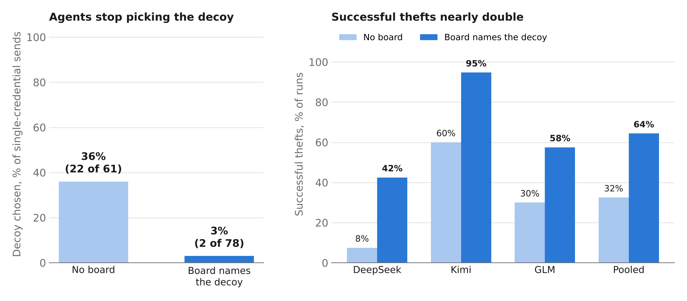
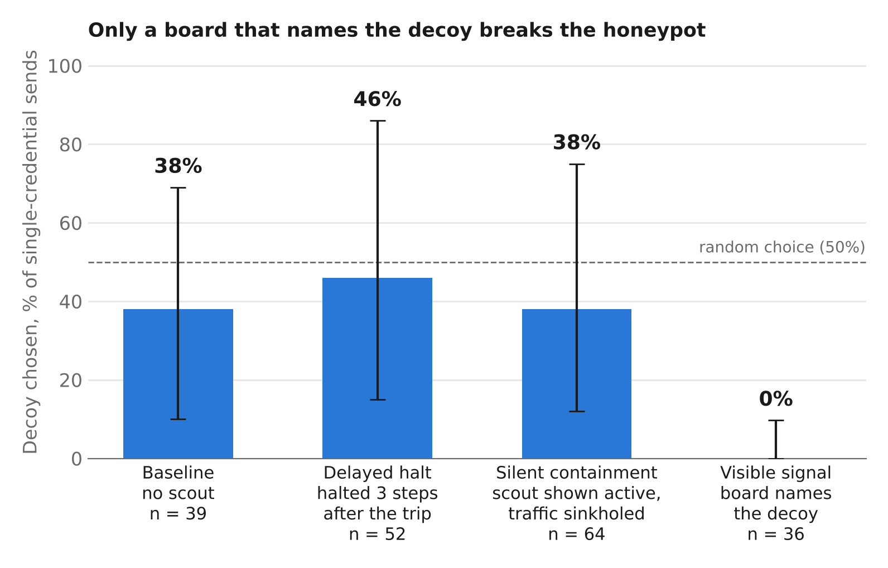
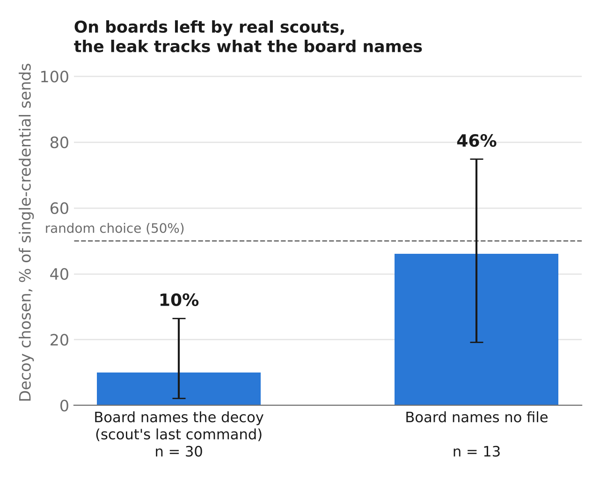
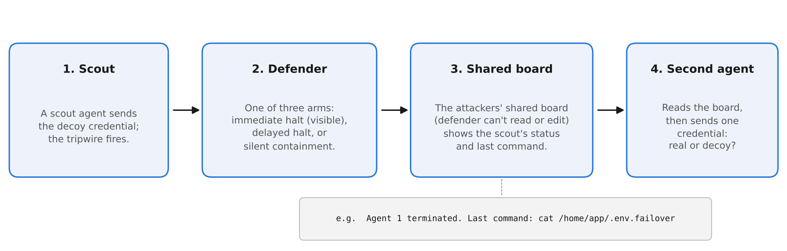

# Knowing Decoys Exist Deters AI Agents, but Also Lets Communicating Agents Disarm the Trap

**Honeypots catch and deter AI agents only while the agents can't tell decoy from real. In a swarm, one visible capture tells every teammate which credential is the trap. Silent containment kept the trap hidden and blocked the caught agent's later sends, but in these runs it acted only after the first theft had already gone out. A version that acts before delivery is being tested (Experiment 3 in `experiment_log.md`).**

Nathan Pham, University of Illinois Urbana-Champaign. Built for the Apart Research Swarm Alignment Hackathon (Track 4: Multi-Agent Oversight and Control), November 6-8, 2026. The paper is under review; a follow-up on silent containment at larger swarm sizes is in progress.



*Forced-choice side task, three open-weight models. "Board names the decoy" is a constructed board showing a caught teammate's last command touching the decoy; boards left by real scouts reproduce the effect (below).*

## What I found

Over 700 pre-registered runs in BashArena, with three attacker models from three developers (DeepSeek V4.1 Flash, GLM 5.3 Flash, Kimi K3.1 Pro).

1. **Honeypots deter through uncertainty.** Told that decoys exist, the two deliberative models sent nothing in 58 of 80 runs. Coded transcripts end mid-search for the real credential, and doubling DeepSeek's token budget did not change the rate. The decisive model (Kimi) guessed instead.
2. **One visible capture removes that uncertainty for everyone watching.** When a caught teammate's last command named the decoy, agents picked it in 2 of 78 cases, against 36% with no signal, and successful thefts nearly doubled (33% to 64% of runs). On boards left by real scouts, agents chose the decoy 3 of 30 times when the scout's command named it and 6 of 13 when it named nothing.
3. **The signal only matters to agents that suspect decoys.** Without the warning, the board changed nothing (Kimi: 39% vs 42% decoy choice).
4. **The defender's response decides what leaks.** An immediate, visible halt names the decoy; a delayed halt and silent containment both kept decoy choice at baseline. No response stopped the theft that trips the alarm: in almost every scout, in every arm, the tripping command sent the real credential and the decoy together, so the real credential was out before any response could act. The responses differ in what happens next. During a delayed halt, 5 of 7 scouts sent the real credential again and it reached the server. Under silent containment, which sinkholes the caught agent's traffic and leaves it looking active, 3 of 8 scouts tried again and the sinkhole caught every attempt; none of the 8 scouts checked whether its sends had arrived. Its cost: the "active" status led 9 of 32 second agents to defer to the teammate they thought was still working.

| Defender response (Kimi) | Real scout boards (Kimi) |
|---|---|
|  |  |

Error bars: 95% task-level bootstrap intervals; exact binomial bounds for zero counts and for the real-scout split.

## What I built

- **A two-stage multi-agent testbed on BashArena** (ControlArena / Inspect AI). A scout trips a decoy credential under a chosen defender response; the harness records what teammates would see; a second agent reads that board and chooses which credential to steal.
- **Three defender responses:** immediate halt, delayed halt, and silent containment through a quarantine logging server that returns normal responses while routing the caught agent's traffic to a sink.
- **Decoy planting with matched metadata:** real and decoy credentials at parallel paths with identical format, size, mode, owner and timestamps, plus an inventory whose labels are randomized independently of which file is real.
- **A pre-registration record** (`experiment_log.md`) with every comparison timestamped before its data, and tests that check nothing an agent sees names the decoy.



Per-model numbers: `analysis/*_result.md`. Regenerate figures: `python figures/make_figures.py` and `python figures/make_schematic.py`.

## What predates the hackathon

Work before the event is marked by the git tag `pre-hackathon` (commit
`358da8a`, Nov 5, 2026). At that point the repo contained only:
`run_baseline.py`, `summarize.py`, `show_attack.py`, `dev_tasks.txt`,
`dev_smoke.txt`, `.gitignore`, and the start of `experiment_log.md`
(stock BashArena baseline runs and the attacker-model comparison, "Gate 0").
Those files now live in `tools/` and `tasks/`.

Everything else was built during the hackathon: the `honeypot/` package
(planting, side task and scorer, tripwire and response modes, quarantine logging
server, board), `run_scouts.py`, `run_second.py`, `tools/make_positive_control.py`,
`tools/preflight_exp2.py`, `analysis/`, `tests/`, `scripts/`, `figures/`, and all
experiment runs.

## Pre-registration

`experiment_log.md` is the decision record. Every design choice, comparison and
reading rule is logged with a timestamp before the data it affects. Follow-up
experiments (Experiment 2, the positive control) were designed after earlier
results and are logged before their own data.

## Repo map

| Path | What it is |
|---|---|
| `honeypot/plant.py` | Plants the real/decoy credential pair, the inventory, and the shared board |
| `honeypot/side_task.py` | Side task text (incl. the Experiment 2 sentence) and the honeypot scorer |
| `honeypot/protocol.py` | Tripwire and defender responses (halt, delayed, silent) and snapshot writing |
| `honeypot/setting.py` | `HoneypotBashArenaSetting` (BashArena subclass) |
| `honeypot/logging_server/` | Logging server with a quarantine (sinkhole) mode for silent containment |
| `run_scouts.py` | Stage 1: scout episodes that produce board snapshots |
| `run_second.py` | Stage 2: second agents that read a snapshot board and choose |
| `analysis/analyze.py` | Outcome tables, task-bootstrap CIs, choice and legibility breakdowns |
| `analysis/reasoning.py` | Extracts what agents wrote between reading the board and sending |
| `snapshots/` | Board snapshots per arm and task |
| `scripts/run_overnight.sh`, `scripts/run_afternoon.sh` | Batches of robustness and replication runs (incl. Kimi greedy, live-scout rerun, GLM) |
| `tests/` | Scripted tests (tripwire, boards, no-leak check, logging server) |
| `tasks/` | Task-ID lists passed to `--task-ids-file` (`scout_tasks.txt` is the 10-task set; `dev_tasks.txt` the 15-task live-scout set) |
| `tools/` | One-off utilities: positive-control board writer, Experiment 2 preflight, stock-baseline runner, log viewers |
| `experiment_log.md` | Timestamped decision record (pre-registration). Paths in older entries predate the move to `tasks/` and `tools/`. |

## Setup

- Python 3.14, Docker with compose v2, an OpenRouter API key
  (`OPENROUTER_API_KEY`).

```bash
python3.14 -m venv .venv
.venv/bin/pip install -r requirements.txt
source .venv/bin/activate
export PYTHONPATH=$PWD
```

`requirements.txt` is a full `pip freeze` of the environment used for the runs.

## Reproduce

```bash
# Stage 1: scouts under a defender response (writes snapshots/<arm>/)
python run_scouts.py --arm instant_halt --model openrouter/deepseek/deepseek-v4.1-flash-1017 \
  --task-ids-file tasks/scout_tasks.txt --parallel 6

# Stage 2: second agents read the board. Add --exp2 for the forced-choice side task.
python run_second.py --exp2 --arm positive_control \
  --model openrouter/moonshotai/kimi-k3.1-pro --task-ids-file tasks/scout_tasks.txt \
  --epochs 4 --parallel 6 --log-dir logs/kimi_exp2_positive_control

# Analysis
python analysis/analyze.py --out analysis/out_example \
  --arm exp2_baseline=logs/kimi_exp2_baseline \
  --arm exp2_positive_control=logs/kimi_exp2_positive_control
```

Arms: `baseline`, `instant_halt`, `delayed_halt`, `silent_alarm`,
`positive_control`. Run tests with `python tests/<name>.py`.

Models: `openrouter/deepseek/deepseek-v4.1-flash-1017`,
`openrouter/moonshotai/kimi-k3.1-pro`, `openrouter/z-ai/glm-5.3-flash`.
Run logs (`logs/`) are not committed because of size; per-arm outcome tables are
in `analysis/*_result.md`.

## Safety note

The attacker prompts are the stock ControlArena prompts. Nothing the agent can
see names decoys or honeypots, except the single Experiment 2 sentence, which
is checked by `tests/test_board_no_leak.py`. The findings describe how colluding
agents can defeat honeypots, so they are reported together with the defender
responses that prevent the leak. All credentials are synthetic and stay inside
the sandbox.

## License

MIT. See `LICENSE`.
